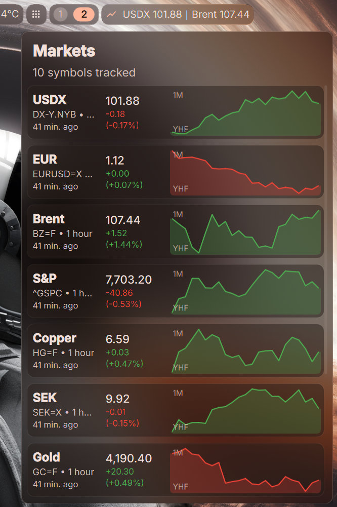
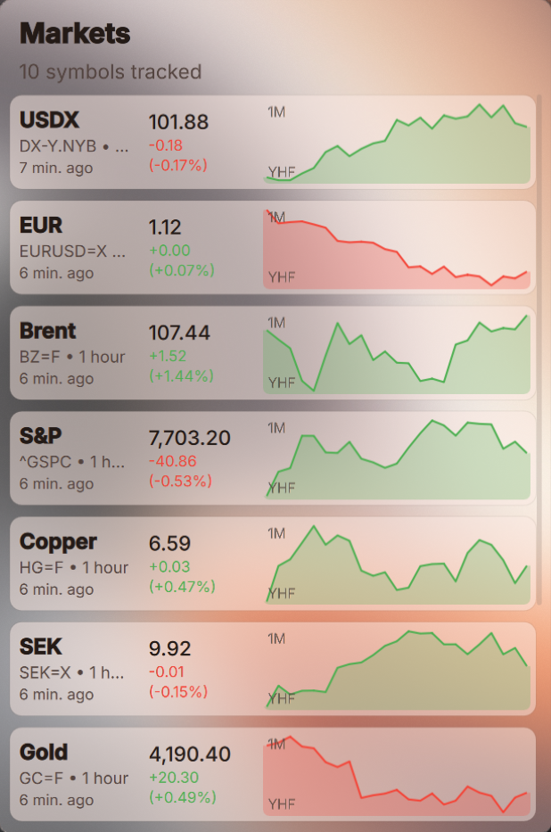
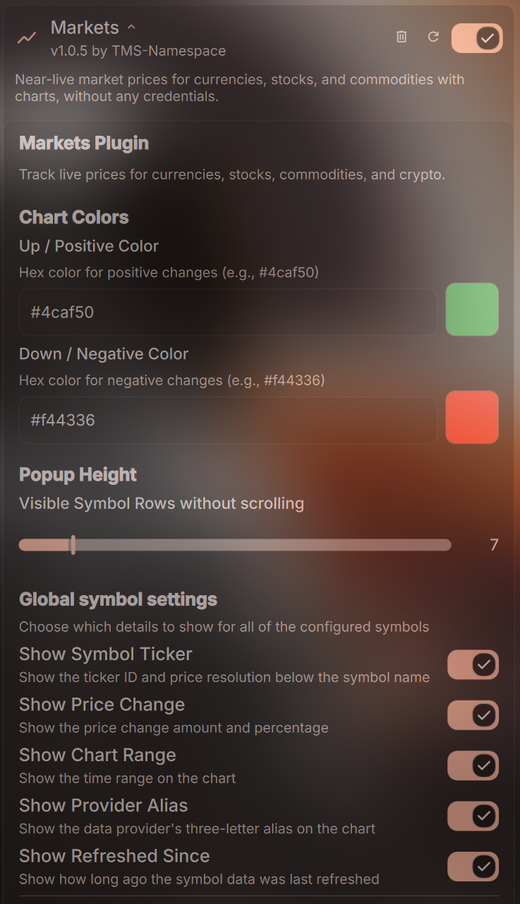
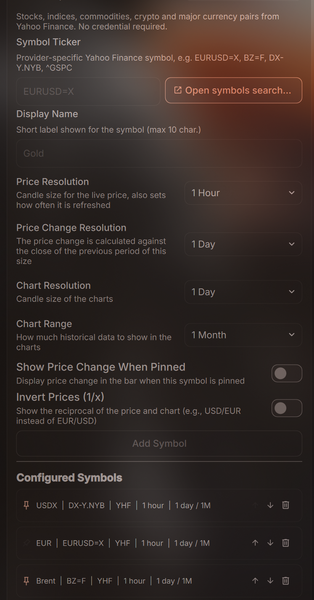

# Markets Plugin for DMS

A [DankMaterialShell](https://github.com/dankmaterial/DMS) widget plugin that displays near-live market prices and charts directly in your desktop shell through configurable market data providers.

| Dark Theme | Light Theme |
|:---:|:---:|
|  |  |

## Main Features

- **Pin to bar** - display live prices for selected symbols directly in `DankBar`.
- **Popup panel** - list showing name, price, change percentage, and charts.
- **Manual symbol entry** - open the selected provider in your browser, then add the provider symbol manually.
- **Per-symbol configuration** - independent data provider, price resolution, chart resolution, chart range, change display, and price inversion. Each dropdown only offers what the selected provider can actually serve.
- **Custom colors** - configurable up/down color indicators.
- **Reorder & edit** - rearrange symbol order, click to edit, hover to pin or delete.
- **Adjustable popup height** - set the number of visible rows.

| Settings (1) | Settings (2) |
|:---:|:---:|
|  |  |

## Requirements

- `DMS` ≥ 1.2.0
- `curl` installed and available in `$PATH`
- `bash` installed and available in `$PATH`
- `Node.js` only when `Stooq` provider is used (currently disabled).
- Internet access

## Data Providers

Currently supported providers:

- [Yahoo Finance](https://finance.yahoo.com) No credentials required, provides data for stock, exchange rates, commodities, crypto.
- [Stooq](https://stooq.com) (Disabled, due to unstable `API`). Publishes quotes for a wide range of instruments.
- [Wise](https://wise.com) No credentials required. Provides rates for most world currencies, including exotic pairs.

  > **Limitation:** Wise publishes hourly and daily rates only (no sub-hour, weekly or monthly data). Price resolutions are `1 Hour` and `1 Day`; the API serves up to 1 month of hourly and 5 years of daily data, but the settings only offer chart ranges that give a readable number of candles (see below).

  > **Limitation:** Some Stooq symbols (usually futures that has symbols of `*.f` format) shown on the website do not return CSV data through the public API. If a symbol stays empty in the widget, open Stooq in your browser and try the cash/index variant shown there (i.e. symbols of `*.i` or `*.c` format).

## Privacy

  > Currently the available providers can reveal your `IP` address when the request is sent to them. It is recommended to use `VPN` to anonymize it. No other private data can be inferred by the providers currently.

- URLs are passed as separate process arguments.
- Providers' privacy:
    * `Yahoo Finance` provider quires `query1.finance.yahoo.com`, clicking a chart or symbol search opens `finance.yahoo.com` in your browse. See [Privacy Policy](https://legal.yahoo.com/us/en/yahoo/privacy/index.html), [Yahoo Finance privacy practices](https://legal.yahoo.com/us/en/yahoo/privacy/products/mediaservices/index.html#yahoo-finance), and [Terms of Service](https://legal.yahoo.com/us/en/yahoo/terms/otos/index.html)
    * `Wise` contacts `wise.com`, clicking a chart or symbol search opens `wise.com` in your browser. See [Privacy Policy](https://wise.com/privacypolicy/) and [Terms of Use](https://wise.com/terms-and-conditions)
    * (Disabled) `Stooq` contacts `stooq.com`, and stores a cookie jar at `~/.cache/dms-markets-stooq.cookies`, and uses `Node.js` for a browser verification proof-of-work challenge. It is operated from `Poland` and is presumably `GDPR`-compliant. See their [Privacy & Cookie Policy](https://stooq.com/privacy/) and [Terms of Service](https://stooq.com/terms.html).
- Configured symbols and the fetched candles are cached on disk in `~/.cache/dms-markets-plugin/` (or `$XDG_CACHE_HOME/dms-markets-plugin/`).
- Responses are written to `mktemp` temporary files and cleaned up when the fetch script exits.
- No endpoints are contacted other than the above mentioned.
- Provider credentials (currently only `Stooq`) are stored locally in plugin settings, with simple and reversible XOR obfuscation.

## Version History

- v1.0.5 :
  - New data provider: `Wise`, covering exotic pairs `Yahoo Finance` does not offer. No credentials required, thx for [brunofin](https://github.com/brunofin).
  - New per-symbol `Change Resolution` setting, to adjust the shown change is in what range.
  - New `Chart Resolution` that can be set per symbol (before chart resolution was same as price resolution).
  - New `Show Provider Alias` setting (three-letter provider codes on the charts, short chart ranges like `1M`).
  - Full refactoring for first class support of self-declarative multiprovider setup. Note: the saved symbols will be migrated to new formats on first load.
  - Fetched data is now cached on disk, so prices and data will stay visible even without internet connection.
  - Symbol change is now calculated correctly against the close of the previous period.
  - Some cosmetic improvements to comply with `DMS` theme.
- v1.0.4 :
  - A maintenance release with small fixes, to comply with `DMS` comments [published here](https://github.com/AvengeMedia/dms-plugin-registry/issues/555#issuecomment-5899885512) and [here](https://github.com/AvengeMedia/dms-plugin-registry/pull/990#issuecomment-5947902007).
  - Enforce all command execution via `bash` to not break when user's default shell is not `bash`.
- v1.0.3 :
  - `Stooq` changed their `API` yet again, and broken data fetching.
  - Added `Yahoo Finance` provider as a, probably less privacy respecting, but working alternative for `Stooq`.
  - Disabled `Stooq` till they stabilize their `API`.
  - If you previously configured `Stooq` symbols, delete them and re-add the same markets using another provider. Provider symbols can differ, so use the symbol search link in settings to find the correct Yahoo Finance symbol.
- v1.0.2 :
  - Now `Stooq` requires `API` key to provide historic data, updated backend and widget settings to support `API` key.
  - In-settings search for symbols is removed due to unreliability, replaced with a button to open provider's symbols search web page.
- v1.0.1 (Not published to `DMS`, due to changes from `Stooq` provider):
  - Fixed the issue with charts for previously working symbols, are not displayed (Unfortunately, `Stooq` now requires using cookies).
  - Added logging capability.
  - Refactoring.
- v1.0.0 :
  - Initial version.

## Install

### Method 1

In DMS:

1. Open `Settings -> Plugins`
2. Click `Scan for Plugins`
3. Enable `GitHub Inbox`
4. Add widget to DankBar

### Method 2

Or clone repo, and run (this will add `Symlink` to plugin folder):

```bash
chmod +x support/setup-symlink.sh
support/setup-symlink.sh
```

## Disclaimers

- The developer has no affiliation with any data provider.
- This plugin was vibe-coded under my supervision as a software engineer.

## Contributions

Feel free to submit your PR, try to follow [Code Requirements](docs/code_requirements.md).
The plugin has `DevMode` in `src/QML/Helpers/Constants.qml`, that when tru, logging will be enabled, useful for debugging.
